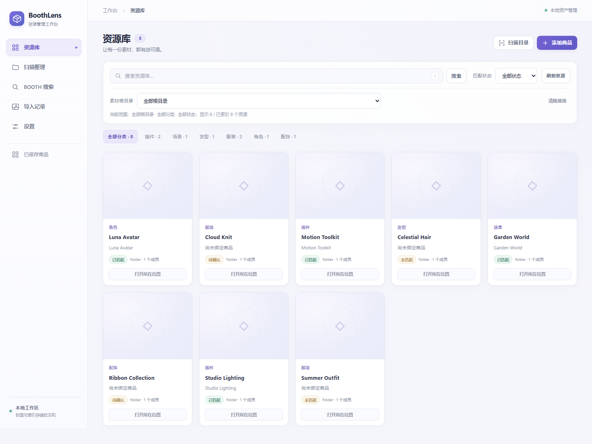
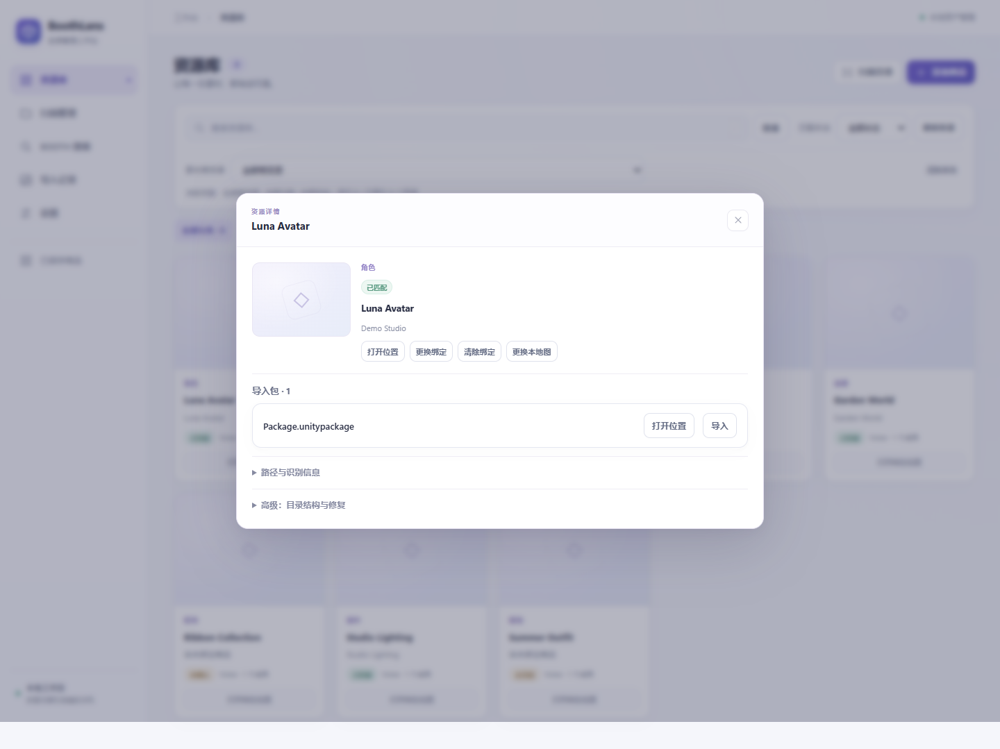

<div align="center">

# BoothLens

### 为你的 BOOTH 素材，建立一个清晰的本地资源库。

**识别商品 · 整理容器 · 确认匹配 · 导入 Unity**

[](https://github.com/SesaliaDarper/BoothLens/releases/latest)


[快速开始](#快速开始) · [功能亮点](#功能亮点) · [使用指南](docs/guide.md) · [下载程序](https://github.com/SesaliaDarper/BoothLens/releases/latest)

</div>

---

BoothLens 是一个 **Windows 本地素材管理工具**。它把下载目录、BOOTH 商品资料、封面与 Unity 导入入口连接起来，不必在文件夹、网页和多个 Unity 工程之间来回寻找。

> 一个完整素材文件夹对应一张卡片。材质、纹理、旧版本与随附归档保留在资源内部，而不是把资源库拆成一堆零散文件。

## 界面预览



<details>
<summary>查看资源详情与导入入口</summary>



</details>

*预览使用虚构条目与示例路径，不含个人素材索引或商品原图。*

## 功能亮点

| | 能做什么 |
|---|---|
| **容器式整理** | 文件夹、归档、Unity 包作为资源入口；保留分类层次，避免内部贴图与源文件铺满列表。 |
| **编号优先识别** | 先校验 BOOTH 编号；编号未命中再按资源文件夹名搜索，名称结果始终由你确认。 |
| **明确的封面规则** | BOOTH 商品封面最高优先级，每个商品只缓存一张图；未绑定时使用可自行替换的本地图。 |
| **纠正而非重来** | 更换或清除错误绑定；普通重扫不会把主动清除的错误编号重新绑回去。 |
| **稳定的目录边界** | 指定“分类目录”或“完整资源”，持久保存；不联网修复索引，保留绑定与素材。 |
| **导入当前 Unity** | 自动发现已打开且安装桥接的 Editor；多工程可选，通过 Unity 原生流程导入 `.unitypackage`。 |
| **本地优先** | SQLite 索引、封面缓存和手动配图保存在本机；Cookie 仅驻留当前进程内存。 |

## 快速开始

### 1 · 获取程序

- 在 [Releases](https://github.com/SesaliaDarper/BoothLens/releases/latest) 下载 **BoothLens-Windows-x64.zip** 并解压。
- 双击 `Start-BoothLens.cmd`。程序在本机启动，并打开 **http://127.0.0.1:5180**。
- 关闭启动窗口停止服务。仅关闭浏览器不会停止服务。

> 仓库保存源代码，不保存你的素材、数据库和已下载封面。Windows 发布包单独提供在 Releases。

### 2 · 扫描与确认

在 **扫描整理** 填写素材根目录 → 预览目录结构 → 开始扫描。编号精确命中直接关联；名称搜索结果出现在待确认列表，由你选择对应商品。

在资源详情可以更换绑定、清除绑定、选择本地配图，以及打开文件所在位置。目录识别有歧义时，在折叠的高级设置中固定分类或资源边界。

### 3 · 连接 Unity

在 **设置** 下载桥接脚本，放到目标工程：

```text
Assets/Editor/BoothRelay.cs
```

也可下载桥接 ZIP，直接解压到 Unity 工程根目录。等待 Unity 编译后，在资源详情选择包并点击 **导入**，再核对目标工程。

## 从源码运行

需要 [.NET 8 SDK](https://dotnet.microsoft.com/download/dotnet/8.0)。浏览器界面为原生 HTML / CSS / JavaScript，不需要前端构建工具。

```bash
git clone https://github.com/SesaliaDarper/BoothLens.git
cd BoothLens
dotnet build BoothLens.sln
dotnet run --project src/BoothLens.App
```

发布 Windows x64 自包含版本：

```bash
bash publish.sh
```

也可以直接执行：

```bash
dotnet publish src/BoothLens.App -c Release -r win-x64 --self-contained true -o release -p:PublishSingleFile=true -p:IncludeNativeLibrariesForSelfExtract=true -p:EnableCompressionInSingleFile=true
```

### 回归检查

```bash
dotnet run --project tests/ContainerCheck
dotnet run --project tests/ContainerCheck/Structural/StructuralCheck.csproj
dotnet run --project tests/BoundaryCheck
dotnet run --project tests/EditorCheck
```

检查使用隔离目录和模拟请求，不需要访问个人素材库。界面预览脚本位于 `tests/browser/showcase.mjs`，需要 Playwright 与 Microsoft Edge，并连接一个独立测试实例。

## 数据与隐私

默认数据目录：`%LOCALAPPDATA%\BoothLens`。升级程序不应删除这个目录；备份前先退出程序，再复制整个目录。

| 环境变量 | 用途 |
|---|---|
| `BOOTHLENS_DATA` | 使用独立数据目录。 |
| `BOOTHLENS_PORT` | HTTP 端口，默认 `5180`。 |
| `BOOTHLENS_BOOTH_COOKIE` | 当前启动使用的 BOOTH Cookie，不写入数据库或日志。 |

源素材保持原位，扫描不改名、不移动、不修改内容。封面、索引和上传的本地图属于 BoothLens 数据目录。程序只监听本机回环地址。

## 项目结构

```text
src/
  BoothLens.App/       ASP.NET Core API 与浏览器界面
  BoothLens.Core/      BOOTH 解析、索引、资源容器与导入逻辑
unity/                Unity Editor 桥接脚本
tests/                隔离回归检查与界面展示脚本
docs/                 使用指南与示例截图
```

## 当前边界

- BOOTH 数据来自非官方接口与页面，站点调整时可能需要更新解析逻辑；本项目与 BOOTH / pixiv 无隶属关系。
- 不包含已购列表全量同步，也不负责下载购买文件。
- RAR / 7z 可识别和关联；导入前需自行解压。当前主要支持 ZIP 和 `.unitypackage`。
- 名称搜索仅提供候选；跨语言译名或相似资源建议人工确认。
- Unity 包的路径与 GUID 由包作者决定，依赖（VRCSDK、lilToon、Modular Avatar 等）需先准备。

更多操作与常见问题见 **[使用指南](docs/guide.md)**。
